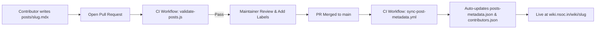

# 📖 WikiNSoC - Official Content Hub for NSoC Wiki

<p align="center">
  <a href="https://wiki.nsoc.in">
    
  </a>
</p>

<p align="center">
  <strong>The open-source content repository and knowledge base powering <a href="https://wiki.nsoc.in">wiki.nsoc.in</a></strong>
  <br />
  Curated by student developers, open-source contributors, and the <strong>Nexus Spring of Code (NSoC)</strong> community.
</p>

<p align="center">
  <a href="https://wiki.nsoc.in"></a>
  <a href="https://github.com/DYHARDx/WikiNSoC/actions/workflows/validate-blog.yml"></a>
  <a href="#how-to-contribute"></a>
  <a href="LICENSE"></a>
</p>

---

## 📌 Table of Contents

- [Overview](#-overview)
- [How It Works](#-how-it-works)
- [How to Contribute](#-how-to-contribute)
- [Article MDX Template](#-article-mdx-template)
- [Homepage Label Guide](#-homepage-label-guide)
- [Reading Time & Word Count Calculation Rules](#-reading-time--word-count-calculation-rules)
- [Local Development & Validation](#-local-development--validation)
- [Automated GitHub Actions](#-automated-github-actions)
- [Contributors & Hall of Fame](#-contributors--hall-of-fame)
- [License](#-license)

---

## 🌟 Overview

**WikiNSoC** is the central documentation repository for **Nexus Spring of Code (NSoC)**. All articles, tutorials, open-source contribution guides, and architectural write-ups written here are automatically parsed, rendered, and showcased live on [wiki.nsoc.in](https://wiki.nsoc.in).

Anyone from complete beginners making their first pull request to seasoned software engineers can write and publish technical articles on the wiki.

---

## ⚡ How It Works



1. **Submit**: Contributors add an `.mdx` file to the `posts/` directory via a GitHub Pull Request.
2. **Automated Validation**: GitHub Actions automatically verifies frontmatter fields, slug formatting, and syntax.
3. **Review & Tagging**: Maintainers review the content and attach relevant labels (e.g. `start-exploring`, `trending-topics`).
4. **Live Synchronization**: Upon merge, GitHub Actions extracts author metadata, computes estimated reading time and word count, and updates both `posts-metadata.json` and `contributors.json`. The web platform instantly serves the new article with dynamic SEO and static page generation.

---

## ✍️ How to Contribute

Making a contribution is beginner-friendly! Follow these simple steps:

### Step 1: Fork and Clone

1. Fork this repository on GitHub by clicking the **Fork** button at the top right.
2. Clone your fork locally:
   ```bash
   git clone https://github.com/your-username/WikiNSoC.git
   cd WikiNSoC
   ```

### Step 2: Create a Feature Branch

Create a descriptive branch for your article or correction:
```bash
git checkout -b post/my-new-article
```

### Step 3: Write Your Article

Create a new file in the `posts/` folder using **lowercase kebab-case**:
```bash
posts/my-new-article.mdx
```

> [!IMPORTANT]
> - Filename **must** use kebab-case (e.g., `git-basics-guide.mdx`, **NOT** `Git_Basics.MDX` or `git basics.mdx`).
> - The filename without `.mdx` becomes your public URL: `https://wiki.nsoc.in/wiki/my-new-article`.

### Step 4: Validate Locally

Before opening a PR, test your file with the built-in validator:
```bash
npm run validate
```
This checks for missing frontmatter, invalid dates, and broken formatting.

### Step 5: Commit and Open a Pull Request

```bash
git add posts/my-new-article.mdx
git commit -m "docs: add wiki article on my-new-article"
git push -u origin post/my-new-article
```
Open a Pull Request on GitHub with a brief description of what your article covers.

---

## 📋 Article MDX Template

Copy and paste this template at the beginning of your `.mdx` file:

```markdown
---
title: "Your Article Title Goes Here"
description: "A concise, engaging 1-2 sentence summary of what readers will learn (used for search engine snippets)."
date: "2026-10-18"
category: "Open Source"
tags:
  - open-source
  - tutorial
  - beginners
coverImage: "https://images.unsplash.com/photo-1522071820081-009f0129c71c?auto=format&fit=crop&w=1200&q=80"
published: true
featured: false
---

# Your Article Title Goes Here

An introductory paragraph explaining why this topic matters and what will be covered.

## Section 1: Getting Started

Write your technical content here using standard Markdown and GitHub-flavored syntax.

### Code Example

```javascript
function helloWorld() {
  console.log("Hello from NSoC Wiki!");
}
```

> [!TIP]
> You can use GitHub-style callouts like TIP, NOTE, IMPORTANT, and WARNING!

## Conclusion

Summarize the key takeaways and provide next steps or resource links for readers.
```

### Frontmatter Fields Reference

| Field | Required | Type | Description |
| :--- | :---: | :--- | :--- |
| `title` | **Yes** | String | The main headline of your article (5–120 characters). |
| `description` | **Yes** | String | A 1–2 sentence summary used for SEO and previews (20–300 characters). |
| `date` | **Yes** | String | Publication date in `YYYY-MM-DD` format (e.g. `2026-10-18`). |
| `category` | **Yes** | String | Primary topic: `Open Source`, `Web Development`, `Cyber Security`, `Technology`, etc. |
| `tags` | No | Array | 2–5 keyword tags for search and categorization. |
| `coverImage` | No | String | Direct URL to a high-resolution hero image (1200×630 recommended). |
| `published` | No | Boolean | Set to `true` (default) or `false` to keep as draft. |
| `featured` | No | Boolean | Set to `true` to request highlighting in featured sections. |

---

## 🏷️ Homepage Label Guide

When maintainers review your Pull Request, they assign PR labels that control where your article appears on the [wiki.nsoc.in](https://wiki.nsoc.in) homepage:

| PR Label | Homepage Section | Description |
| :--- | :--- | :--- |
| `start-exploring` | **Start Exploring** | Featured in the primary quick-start cards on the homepage. |
| `trending-topics` | **Trending Topics** | Featured in the community trending topics card list. |
| `featured-articles` | **Featured Showcase** | Displayed in the homepage hero grid. |
| `knowledge-for-everyone` | **Knowledge Base** | Fundamental tutorials and core engineering guides. |
| `tools` | **Tools & Tooling** | Developer tools, terminal guides, and environment setups. |
| `open-source` | **Open Source** | Guides on Git, PR workflows, and repository contributions. |
| `cyber-security` | **Security & SOC** | Defensive security, threat hunting, and log telemetry. |
| `web-development` | **Web Standards** | Modern Next.js, React, backend APIs, and web engineering. |

---

## 📊 Reading Time & Word Count Calculation Rules

Article cards and reading headers on [wiki.nsoc.in](https://wiki.nsoc.in) display word counts and estimated reading times sourced from `posts-metadata.json`. These metrics are computed automatically using predictable, consistent counting rules:

1. **Frontmatter Exclusion**:
   - YAML frontmatter located at the beginning of the file (between opening and closing `---` delimiters) is stripped before counting.
2. **Code Blocks Exclusion**:
   - Fenced code blocks (enclosed with ` ``` ` or `~~~`, including language tags like ```` ```javascript ```` or ```` ```mermaid ````) are skipped so technical syntax and ASCII diagrams do not skew prose reading velocity.
   - Inline code spans (e.g. `` `npm run build` ``) remain part of the readable prose and are counted.
3. **Word Count Computation**:
   - The remaining body content is trimmed of leading and trailing whitespace.
   - Text is split into words by whitespace sequences (`/\s+/`).
   - Words array is filtered to ignore empty tokens.
   - If a post has no prose content, `wordCount` is `0`.
4. **Estimated Reading Time Computation**:
   - Standard reading speed of **200 words per minute (WPM)** is used (the established standard for web documentation and blogs).
   - Formula: `Math.ceil(wordCount / 200)`
   - Minimum threshold: For non-empty posts (`wordCount > 0`), the minimum estimated reading time is **1 minute** (`Math.max(1, Math.ceil(wordCount / 200))`). For empty posts (`wordCount === 0`), reading time is `0`.

### Summary Reference Table

| Post | Body Words | Calculation (200 WPM) | `wordCount` | `readingTime` |
| :--- | :--- | :--- | :--- | :--- |
| `nsoc-announcement` | 4 words | `Math.max(1, Math.ceil(4 / 200))` | `4` | `1` min |
| `nexus-spring-of-code-2027` | 774 words | `Math.ceil(774 / 200)` | `774` | `4` min |
| `what-is-nexus-spring-of-code` | 1128 words | `Math.ceil(1128 / 200)` | `1128` | `6` min |

---

## 🛠️ Local Development & Validation

This repository includes standalone scripts that require **Node.js (v18+)** and zero extra npm dependencies.

```bash
# Validate all MDX posts in posts/
npm run validate

# Or validate a specific file
node scripts/validate-posts.js posts/my-post.mdx

# Calculate word count & estimated reading time for a post
node scripts/calculate-post-stats.js posts/my-post.mdx

# Sync or backfill posts-metadata.json
npm run sync:metadata

# Sync contributors.json manually
npm run sync:contributors

# Run unit tests
npm test
```

---

## 🤖 Automated GitHub Actions

- **`validate-blog.yml`**: Runs on every pull request targeting `posts/**/*.mdx`. Ensures no broken frontmatter or malformed slugs can get merged.
- **`ai-pr-review.yml` (Gemini 1.5 Flash)**: Automatically analyzes newly submitted articles for:
  - 📋 **Executive Summary**: 2-3 sentence overview of what the article teaches.
  - 🔍 **Self-Promotion & Credit Audit**: Detects personal agency plugs or excessive self-marketing.
  - 🔗 **Backlink & Link Audit**: Flags suspicious affiliate or spam SEO links.
  - 🔄 **Redundancy Check**: Ensures no duplicate topics with existing community posts.
  - ⚖️ **Maintainer Verdict**: Quick 🟢 Clean / 🟡 Revisions / 🔴 Spam verdict posted directly as a PR comment.
- **`sync-post-metadata.yml`**: Triggers upon PR merge to `main`. It extracts the PR author (`assignees` / `pr.user`) and GitHub labels, computes `wordCount` and estimated `readingTime` (ignoring frontmatter and code blocks), updates `posts-metadata.json`, runs `sync-contributors.js` to update `contributors.json`, and commits them back to `main`.

---

## 🏆 Contributors & Hall of Fame

Every merged pull request automatically records the author in [`contributors.json`](contributors.json) and showcases them on the live [wiki.nsoc.in/contributors](https://wiki.nsoc.in/contributors) Hall of Fame!

Thank you to all our open-source contributors:

<!-- AUTO-GENERATED-CONTRIBUTORS-START -->
<p align="center">
  <a href="https://github.com/DYHARDx">
    
  </a>
</p>
<!-- AUTO-GENERATED-CONTRIBUTORS-END -->

---

## 📄 License

This repository and all wiki documentation are licensed under the [MIT License](LICENSE).
Feel free to read, learn, share, and contribute!
