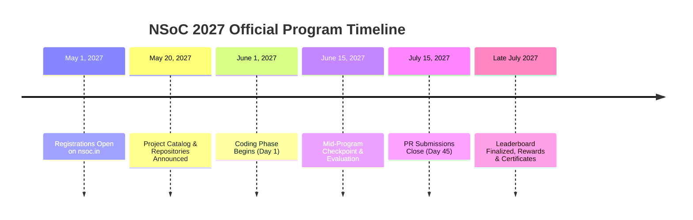

We are thrilled to officially unveil the future schedule for **Nexus Spring of Code (NSoC) 2027**! 💻

Following the overwhelming reception of our inaugural programs, Nexus is formalizing its long-term calendar. **Starting in 2027, NSoC will take place once every year**, establishing an annual summer tradition where student developers, open-source contributors, project maintainers, and university communities unite for an intensive season of hands-on learning, collaborative engineering, and impactful software development.

> [!IMPORTANT]
> **Save the Dates**: Bookmark the official portal at [https://nsoc.in](https://nsoc.in/) for real-time notification alerts, project reveals, and partner announcements as the registration date approaches.

---

## 📅 Key Dates & Program Timeline

Mark your calendars! The 2027 edition will run during the peak summer break, providing students with uninterrupted focus to dive deep into production-grade engineering.

| Milestone | Date | Details |
| :--- | :--- | :--- |
| 📝 **Registrations Open** | **1 May 2027** | Contributor, Project Admin, and Campus Ambassador applications open on [nsoc.in](https://nsoc.in/). |
| 🔍 **Project Catalog Reveal** | **20 May 2027** | Accepted open-source repositories and maintainer mentors are announced. |
| 🔥 **Coding Window Begins** | **1 June 2027** | Official program kickoff - issue assignments and pull request submissions begin. |
| 🏁 **Program Wrap-up** | **15 July 2027** | Final PR submission cutoff (45 days of coding and collaboration). |
| 🏆 **Results & Awards** | **Late July 2027** | Leaderboard finalization, certificates issued, and physical swags dispatched. |

---

## 🌟 What to Expect in NSoC 2027?

NSoC 2027 expands on everything that made previous editions impactful while introducing higher scalability, better mentoring frameworks, and stronger industry connections:

### 1. Production-Grade Open-Source Projects
Say goodbye to basic toy tutorials. Maintainers from diverse tech ecosystems will onboard repositories across:
- **Full-Stack & Cloud**: Modern Next.js, React, Node.js, Go, Python, and microservice architectures.
- **Systems & Security**: Rust utilities, networking tooling, cybersecurity monitors, and API gateways.
- **Mobile & Emerging Tech**: Flutter, Kotlin, AI/ML integrations, and developer productivity tooling.

### 2. Meaningful Issues & PR Workflows
Every task is vetted for engineering value. You will:
- Tackle genuine user-facing bugs, architectural refactors, and feature additions.
- Practice industry-standard Git hygiene: semantic commits, atomic branches, and comprehensive test suites.
- Receive direct, line-by-line feedback during maintainer code reviews.

### 3. Direct Collaboration with Project Admins
Rather than working alone, contributors collaborate with experienced maintainers who provide architectural direction, review pull requests, and offer mentorship throughout the 45-day window.

### 4. Expansion of NSoC Chapters
2027 marks the planned rollout of **NSoC Chapters** across college campuses. Campus Ambassadors and student leads will be able to organize local hack sessions, open-source workshops, and study groups directly within their universities.

---

## 🎁 Rewards, Recognition & Career Opportunities

Hard work deserves tangible recognition. NSoC 2027 is doubling down on incentives for contributors who show consistency and technical excellence:

- 📜 **Verified Certificates**: Official Certificates of Completion and Merit verified via unique cryptographic hashes.
- 👕 **Exclusive Physical Swag**: Curated swag kits including high-quality custom T-shirts, stickers, developer hoodies, and badges for top-tier contributors.
- 💼 **Job & Internship Referrals**: Direct referrals to partner startups and technology companies looking to hire developers with proven open-source track records.
- 🌟 **Wiki Hall of Fame**: Top contributors will be featured prominently on the [wiki.nsoc.in/contributors](https://wiki.nsoc.in/contributors) directory.

> [!TIP]
> **More Rewards on the Way!** We are actively partnering with global dev-tool companies and tech sponsors. Keep checking the official website for surprise bonus drops and reward tier announcements!

---

## 🛠️ How to Prepare Between Now and May 2027

You don't need to wait until May 2027 to start your journey. Here is how you can get ahead today:

1. **Master Git & GitHub Fundamentals**: Familiarize yourself with forking, branching, interactive rebasing, and resolving merge conflicts.
2. **Contribute to WikiNSoC**: Start right now by writing technical guides or improving documentation in our [WikiNSoC Repository](https://github.com/DYHARDx/WikiNSoC).
3. **Engage with the Community**: Join technical discussions on our community talk board at [/talk](/talk) and connect with fellow developers.
4. **Follow Founder Updates**: Connect with founder [Aman Singh on LinkedIn](https://www.linkedin.com/in/dyhardx/) for behind-the-scenes announcements and timeline previews.

---

## 🔔 Stay Connected

Whether you're a beginner making your very first open-source contribution or an experienced developer looking to lead an ambitious project, **NSoC 2027** is built for you.

- 🌐 **Official Website**: [https://nsoc.in](https://nsoc.in/)
- 📖 **Knowledge Hub**: [https://wiki.nsoc.in](https://wiki.nsoc.in/)
- 💬 **Discord Community**: [https://discord.gg/bZ47fac2jn](https://discord.gg/bZ47fac2jn)
- 💼 **LinkedIn Company**: [https://www.linkedin.com/company/nso-code](https://www.linkedin.com/company/nso-code)
- 📸 **Instagram**: [https://www.instagram.com/nsoc_in](https://www.instagram.com/nsoc_in)
- 📺 **YouTube**: [https://www.youtube.com/@nsoc-in](https://www.youtube.com/@nsoc-in)
- 💬 **Community Discussions**: [/talk](/talk)
- 🤝 **Contribute to the Wiki**: [GitHub: DYHARDx/WikiNSoC](https://github.com/DYHARDx/WikiNSoC)

*Save the dates. Polish your skills. Get ready to build, contribute, and grow with NSoC 2027!* 🚀
