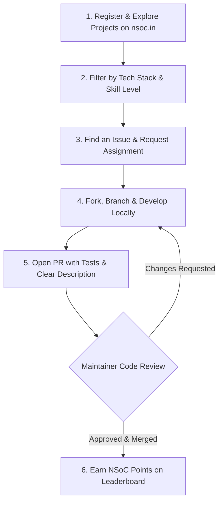

Software engineering is rarely mastered through isolated syntax quizzes or repetitive todo-app tutorials. The true craft of modern software engineering happens in collaborative codebases: diagnosing complex bugs, reading foreign architectures, discussing trade-offs in pull request threads, and shipping real code used by actual humans.

That exact realization sparked the creation of **Nexus Spring of Code (NSoC)**.

Founded by **[Aman Singh on LinkedIn](https://www.linkedin.com/in/dyhardx/)**, Nexus was established on **10 January 2026**, with its inaugural program launching on **14 March 2026**. Today, NSoC stands as a premier open-source movement engineered to help students, aspiring engineers, and experienced developers step out of "tutorial hell" and into high-impact, production-grade software development.

> [!NOTE]
> **Official Portal**: Explore ongoing cohorts, featured repositories, and program timelines directly on the official platform at [https://nsoc.in](https://nsoc.in/).

---

## 💻 What is Nexus Spring of Code?

**Nexus Spring of Code (NSoC)** is an intensive, highly structured **45-day open-source development initiative**.

During the program, curated open-source organizations and project maintainers bring real-world, active codebases to the table. Contributors from across colleges, universities, and global developer circles claim genuine issues, engineer features, squash edge-case bugs, write automated test suites, and submit pull requests under the direct mentorship of seasoned project admins.

```
                    ┌──────────────────────────────────────────────┐
                    │       Nexus Spring of Code (NSoC)            │
                    │         "Learn. Build. Contribute. Grow."    │
                    └──────────────────────┬───────────────────────┘
                                           │
         ┌─────────────────────────────────┼─────────────────────────────────┐
         ▼                                 ▼                                 ▼
┌──────────────────┐             ┌──────────────────┐             ┌──────────────────┐
│   Contributors   │             │  Project Admins  │             │Campus Ambassadors│
│  Explore, Build, │             │ Curate, Mentor,  │             │Evangelize, Lead, │
│  Submit PRs, Win │             │ Review, & Merge  │             │Host Campus Events│
└──────────────────┘             └──────────────────┘             └──────────────────┘
```

The underlying mission is simple yet transformative: **help developers move beyond superficial tutorials and learn by building, collaborating, and shipping real projects.**

---

## 🌟 Who Can Participate?

NSoC is designed around three collaborative pillars. Whether you write code, manage software architectures, or love building grassroot communities, there is a dedicated track for you:

### 1. 🔹 Contributors
*Are you eager to level up your technical chops on real production code?*

Contributors are the lifeblood of NSoC. As a contributor, you will:
- **Discover Repositories**: Browse curated projects spanning web apps, microservices, mobile applications, developer tools, and security utilities.
- **Tackle Genuine Issues**: Resolve real bugs, refactor legacy logic, optimize query performance, and ship brand-new feature modules.
- **Master GitHub Workflows**: Learn how git rebase, squash commits, semantic commit messages, and automated CI/CD pipelines work in production.
- **Earn Points & Recognition**: Each approved and merged contribution earns points on the official NSoC Leaderboard.

### 2. 🔹 Project Admins (Maintainers)
*Do you maintain an open-source project or lead an active engineering codebase?*

Project Admins drive the architectural direction and review standards for NSoC repositories:
- **Project Governance**: Curate well-defined issues with detailed reproduction steps, acceptance criteria, and clear labels (`good first issue`, `help wanted`, `priority: high`).
- **Technical Mentorship**: Guide junior developers through architectural patterns, code styling, test coverage, and security sanity checks.
- **Code Reviews**: Provide constructive, line-by-line PR feedback and maintain repository stability.
- **Drive Project Growth**: Accelerate your project's roadmap with motivated contributors from around the world.

### 3. 🔹 Campus Ambassadors (CAs)
*Are you a student leader passionate about community building and technical evangelism?*

Campus Ambassadors bridge NSoC and university campuses:
- **Campus Evangelism**: Represent NSoC across college technical societies, clubs, and hackathon networks.
- **Host Workshops**: Organize hands-on Git & GitHub bootcamps, open-source orientation sessions, and code-along meetups.
- **Onboard Newcomers**: Help first-time contributors configure local environments, fork repos, and open their very first Pull Request.
- **Build Developer Networks**: Cultivate an active peer-learning culture within your college that lasts far beyond graduation.

---

## 🛠️ How Does It Work?

Participating in NSoC follows an organized, transparent lifecycle designed to ensure high code quality and fair recognition:



### The 5-Step Contribution Journey

1. **Register on Official Platform**: Create your profile on [https://nsoc.in](https://nsoc.in/) and browse the catalog of accepted projects.
2. **Select Your Project**: Filter by language (TypeScript, Python, Go, Rust, Java), domain (Cloud, Frontend, Systems, Security), or issue difficulty.
3. **Get Assigned Before Coding**: Avoid redundant work! Comment on the issue to discuss your planned implementation and wait for the Project Admin to assign you.
4. **Build, Test & Submit PR**: Write clean code, add documentation or tests where applicable, and open a descriptive Pull Request referencing the issue (e.g., `Fixes #42`).
5. **Review, Merge & Score**: Collaborate with maintainers during the code review phase, address comments, get your code merged to `main`, and collect program points!

> [!TIP]
> **Pro Contributor Tip**: Never submit a Pull Request without an assigned issue. Communicating upfront with maintainers saves time and guarantees your architectural approach matches project expectations.

---

## 🏆 Why Join NSoC?

Participating in Nexus Spring of Code gives you advantages that traditional coursework cannot match:

| Benefit | What You Actually Gain |
| :--- | :--- |
| **Real-World Experience** | Work on live production codebases rather than isolated sandbox exercises. |
| **Industry Git & GitHub Skills** | Master branching strategies, merge conflict resolution, CI workflows, and code review etiquette. |
| **Rock-Solid Developer Portfolio** | Replace empty résumé lines with verifiable GitHub pull requests, commits, and merged code. |
| **Direct Mentorship** | Get personal code feedback from experienced maintainers and senior developers. |
| **Rewards, Swags & Certifications** | Earn verified certificates of excellence, official physical swags, and potential job referrals. |
| **Global Community** | Network with hundreds of ambitious student builders, maintainers, and tech leaders. |

### 🎁 More Rewards on the Way!

The NSoC organizing team is continually expanding partner sponsorships and reward tiers. Top-ranking contributors, active maintainers, and standout campus ambassadors can look forward to:

- 🎖️ **Official NSoC Certificates of Completion & Merit**
- 👕 **Exclusive Swag Kits** (Custom T-shirts, stickers, developer hoodies, and badges)
- 💼 **Job & Internship Referrals** with partner startups and tech companies
- 🌟 **Feature Spotlight** on the official [wiki.nsoc.in](https://wiki.nsoc.in) Hall of Fame

Keep checking [https://nsoc.in](https://nsoc.in/) for real-time announcements as new sponsors and reward tiers unlock!

---

## 🧭 The Core Philosophy

> ### *"Learn. Build. Contribute. Grow."*

At its core, **Nexus Spring of Code** is not a competition where you cut corners for quick points. It is a collaborative incubator. It teaches you how to read someone else's code with empathy, how to accept architectural feedback with grace, and how to write software that stands the test of time.

Whether you are writing your first line of open-source markdown or optimizing asynchronous queues in high-throughput backends, NSoC is where you level up.

---

## 🔗 Official Links & Resources

- 🌐 **Official Website**: [https://nsoc.in](https://nsoc.in/)
- 📖 **Official NSoC Wiki & Blog**: [https://wiki.nsoc.in](https://wiki.nsoc.in/)
- 💬 **Discord Community**: [https://discord.gg/bZ47fac2jn](https://discord.gg/bZ47fac2jn)
- 💼 **LinkedIn Company Page**: [https://www.linkedin.com/company/nso-code](https://www.linkedin.com/company/nso-code)
- 📸 **Instagram**: [https://www.instagram.com/nsoc_in](https://www.instagram.com/nsoc_in)
- 📺 **YouTube Channel**: [https://www.youtube.com/@nsoc-in](https://www.youtube.com/@nsoc-in)
- 🔗 **Founder**: [Aman Singh on LinkedIn](https://www.linkedin.com/in/dyhardx/)
- 💬 **Community Discussions**: [wiki.nsoc.in/talk](https://wiki.nsoc.in/talk)
- 🤝 **Contribute to this Wiki**: [GitHub: DYHARDx/WikiNSoC](https://github.com/DYHARDx/WikiNSoC)

---

## 🚀 Ready to Make Your Mark?

The next cohort is gearing up. Don't let your code stay trapped on localhost. Register today, claim your first issue, and start building software that the world can use!

```bash
# Get started with git today
git clone https://github.com/DYHARDx/WikiNSoC.git
cd WikiNSoC
npm run validate
```

*Welcome to the movement. Welcome to Nexus Spring of Code!*
